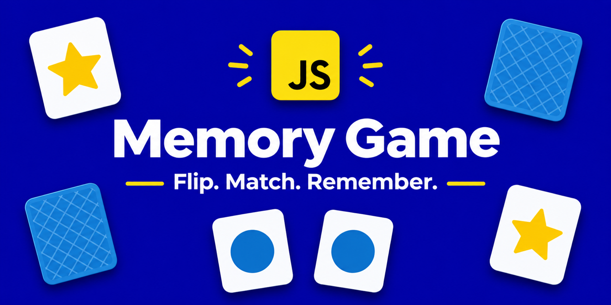
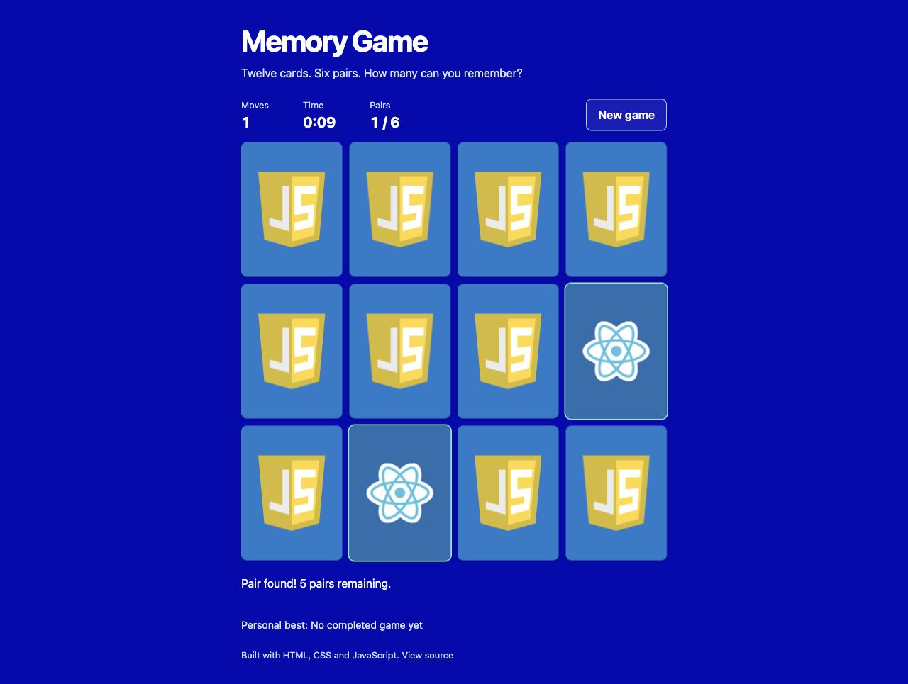

# Memory Game

**Flip. Match. Remember.** A small card matching game built with HTML, CSS and vanilla JavaScript. Find six pairs of framework logos while tracking your moves and elapsed time.

[](https://github.com/stefisha/memory-game/actions/workflows/ci.yml)



## Play locally

Clone the repository and serve its `public` directory with Python 3:

```sh
git clone https://github.com/stefisha/memory-game.git
cd memory-game
python3 -m http.server 5173 --directory public
```

Open [localhost:5173](http://localhost:5173). On Windows, use `py -m http.server 5173 --directory public` if Python is installed through the launcher. Any static web server can serve the same directory. The game has no build step, backend, accounts or API keys.

## How to play

1. Select a card to reveal its logo. The timer starts on your first selection.
2. Select a second card. Each pair of selections counts as one move.
3. Matching cards stay face up. Unmatched cards turn back after one second.
4. Find all six pairs to finish. Select **New game** to shuffle and start again.

Use a mouse or touch, or press **Tab** to move between cards and **Enter** or **Space** to reveal one. The layout adapts to phone and desktop widths. Motion follows the browser's reduced-motion preference.

Your personal best is the completed game with the fewest moves. Ties are decided by elapsed time. It is stored only in this browser using `localStorage`; clearing browser data removes it. The game remains playable when storage is blocked. There is no shared leaderboard or score verification.

## Implementation

The game keeps a single active selection and briefly locks the board during a mismatch. Restarting cancels pending callbacks and resets the timer. Fisher–Yates shuffling determines both visual and keyboard order. Card buttons expose their revealed and matched states to assistive technology, and game announcements use a live status region.

```text
public/
  index.html       Game page and accessible card buttons
  scripts.js       Matching logic, shuffle, timer and personal best
  styles.css       Responsive layout and card flip animation
  img/             Local card artwork
tests/            Automated browser-logic checks
docs/             Banner, screenshot and social preview
```

For static hosting, publish the contents of **`public/`**, which contains the actual application and all its assets.

## Development checks

Node.js 22.12 or later within version 22, or Node.js 24, is needed only for development checks:

```sh
npm ci
npm run check
npm test
```

Seven tests exercise deck integrity and asset paths, duplicate clicks, mismatch locking, restarting during a pending flip, completion, timer handling, personal-best comparisons and unavailable or corrupt browser storage. CI runs the checks on Node.js 22 and 24 and checks dependencies for known vulnerabilities.

## Project context

Completed as part of a JavaScript developer internship at [Levi9](https://github.com/Levi9).

## Credits

This learning project follows [Marina Ferreira's Memory Game tutorial](https://marina-ferreira.github.io/tutorials/js/memory-game/), including the original framework card artwork and blue flip-card design. Framework names and logos belong to their respective owners.

The repository banner is AI generated. The screenshot shows the running application.
